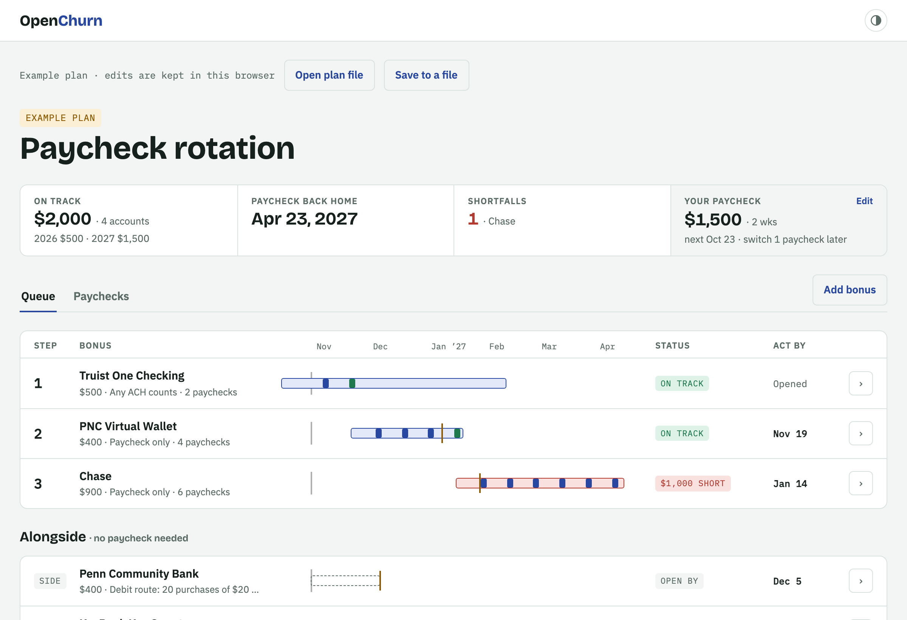

# OpenChurn

[](https://www.npmjs.com/package/openchurn)
[](https://github.com/thetemplateblog/openchurn/actions/workflows/ci.yml)
[](https://badge.socket.dev/npm/package/@openchurn/planner/1.0.0)
[](LICENSE)

Plan bank sign-up bonuses around one paycheck, on your own computer.

Most direct-deposit bonuses want your paycheck, and you only have one. Put the bonuses in order and OpenChurn tells you
when to open each account, when to switch your payroll, which paycheck goes where, and where you'll fall short. Your
plan is a file you own. Nothing leaves your computer.



## Run it

**With Node (any browser):**

```sh
npx openchurn
```

This starts OpenChurn and prints a link to open in your browser. Your plan saves to `~/OpenChurn/plan.json` as you edit. To use another file:

```sh
npx openchurn ./my-plan.json
```

Option: `--port 4580` to pick the port. The server only listens on your own
computer (`127.0.0.1`) and only reads and writes the one plan file.

**With nothing installed:** download `openchurn.html` from the [latest release](https://github.com/thetemplateblog/openchurn/releases/latest)
and double-click it. It works offline. Or use it online at
[thetemplateblog.github.io/openchurn](https://thetemplateblog.github.io/openchurn/); your plan still stays on your computer.

- In Chrome, Edge, Brave and Opera, choose **Open plan file** or **Save to a file**, and edits save to that file.
- Safari and Firefox don't let web pages write files. There, your plan is kept in the browser; use **Download plan** to
  save a copy and **Open plan file** to load one.

## What it does

- **Queue:** your payroll bonuses in order. Each gets the next paychecks that fit its deposit window, with the date to
  open the account and submit the payroll change.
- **Shortfalls:** bonuses that can't be met, by how much, and what would fix it.
- **Alongside:** bonuses that need no direct deposit (debit purchases, balance holds), with their open-by dates.
- **Completed:** bonuses you've received, totaled by year.
- **Paychecks:** a payday-by-payday ledger of where each paycheck goes and progress toward each target.

### Assumptions

The plan assumes you open each account and submit the payroll change on the same day, each paycheck posts on payday,
and the deposit window starts the day you open the account. "Switch takes effect" is how many paychecks after you
submit the change it reaches the new bank. Always confirm every requirement on the bank's own offer page. The example
plan's bonuses are illustrative, not current offers.

### Worked example

$1,500 every two weeks, next payday 2026-10-23, the switch taking effect one paycheck later:

- Truist (any ACH counts, $2,000 in 120 days, already open) is met Nov 20.
- PNC opens by Nov 19 and is met Jan 15.
- Chase opens by Jan 14, gets 6 paychecks and is $1,000 short.
- Payroll goes back to your main bank Apr 23, 2027.

This is a test in [`packages/planner/src/planner.test.ts`](packages/planner/src/planner.test.ts).

## The plan file

Readable JSON with a version number:

```json
{
  "openchurn": 1,
  "pay": { "amount": 1500, "freqDays": 14, "nextPayday": "2026-10-23", "switchLead": 1 },
  "bonuses": [
    { "id": "…", "name": "Truist One Checking", "bonusAmount": 500, "rule": "ach", "target": 2000, "minDeposits": 2, "windowDays": 120, "…": "…" }
  ]
}
```

`rule` is `"payroll"` (paycheck only), `"ach"` (any incoming ACH counts) or `"none"` (no direct deposit). Dates are
`YYYY-MM-DD`, or `""` when not set.

## The rules as a library

The planning rules are a separate package with no dependencies:

```sh
npm install @openchurn/planner
```

```ts
import { computePlan, parsePlanFile, todayUTC } from "@openchurn/planner";

const file = parsePlanFile(text);
if (file.ok) {
  const plan = computePlan(file.plan, todayUTC());
  console.log(plan.rotation.map((r) => `${r.step}. ${r.bonus.name}: ${r.status}`));
}
```

## Develop

```sh
npm install
npm run dev      # the app with hot reload (saves in the browser)
npm start        # build everything and run the openchurn command
npm test         # rule tests and local server tests
```

- `packages/planner`: the rules, plan file format and their tests (`@openchurn/planner`).
- `app`: the planner UI (Vite + React).
- `cli`: the `openchurn` command and its local server.

See [CONTRIBUTING.md](CONTRIBUTING.md). Pull requests are welcome.

## OpenChurn and ChurnTracker

OpenChurn is the free planner from [ChurnTracker](https://churntracker.app), open source. ChurnTracker adds an account that
saves your plan across devices, live tracking of deposits and purchases from your linked banks, and more than one
paycheck. The ChurnTracker name and logo aren't covered by this project's license.

## License

[MIT](LICENSE)
